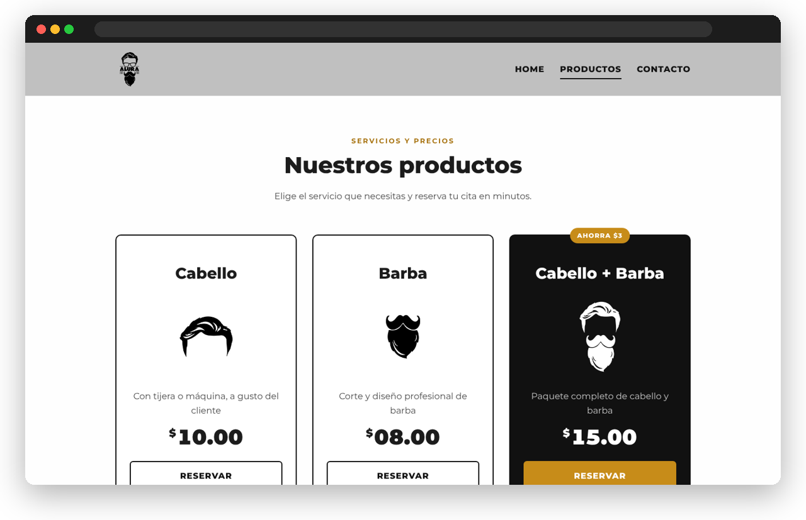
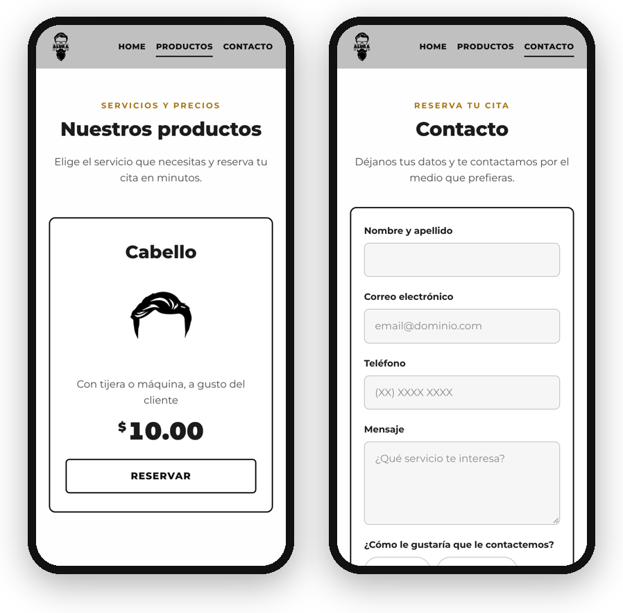

<div align="center">



<br><br>


<br><br>

<a href="https://gerlynfp.github.io/Barberia-Alura/"><strong>Ver el sitio en vivo →</strong></a>

</div>

---

## Sobre el proyecto

Sitio web de una barbería ficticia con tres páginas: inicio, servicios con precios y contacto. Empezó como un proyecto de práctica de HTML y CSS y luego lo rediseñé para que sea responsivo y tenga animaciones suaves, sin perder la identidad original: grises, dorado, la tipografía Montserrat y el logo.

<div align="center">

</div>

## Páginas

| Página | Qué tiene |
| --- | --- |
| **Inicio** | Portada con foto, historia y misión, servicios con precios, ubicación con mapa, diferenciales y video |
| **Productos** | Tres servicios con precio, botón para reservar y el paquete completo destacado |
| **Contacto** | Formulario con validación, forma de contacto preferida y horario de atención |

## En el celular

<div align="center">

</div>

## Detalles

- **Responsivo:** se adapta a celular, tablet y escritorio, con la cabecera fija arriba.
- **Animaciones:** la portada aparece al cargar, el contenido y las fotos se revelan al hacer scroll, y las tarjetas y botones responden al tocarlos.
- **Accesible:** textos alternativos, enlace para saltar al contenido, foco visible con el teclado y animaciones reducidas si el sistema lo pide (`prefers-reduced-motion`).
- **Rápido:** el video de YouTube se carga solo al hacer clic, y las fotos tienen varios tamaños para cada pantalla.
- **Sin librerías:** solo HTML, CSS y JavaScript.

## Estructura

```
├── index.html       Inicio
├── productos.html   Servicios y precios
├── contacto.html    Formulario y horario
├── style.css        Estilos y animaciones
├── reset.css        Reinicio de estilos
├── main.js          Scroll, formulario y video
├── imagenes/        Logo, íconos y fondos
└── banner/          Fotos de respaldo
```

## Cómo verlo en tu computadora

```bash
git clone https://github.com/GerlynFP/Barberia-Alura.git
cd Barberia-Alura
```

Abre `index.html` en tu navegador. No hace falta instalar nada.

## Créditos de fotos

Fotos de [Unsplash](https://unsplash.com), libres de uso bajo la [Licencia de Unsplash](https://unsplash.com/license):

- Portada: [T](https://unsplash.com/@tanyabarrow)
- Herramientas: [Andrea Donato](https://unsplash.com/@andreadonato)
- Barbero con navaja: [Agustin Fernandez](https://unsplash.com/@agustinfernandez)
- Interior de barbería: [Barney Goodman](https://unsplash.com/@bgoodpic)

---

<div align="center">

Hecho por <a href="https://github.com/GerlynFP"><strong>Gerlyn</strong></a>

</div>
